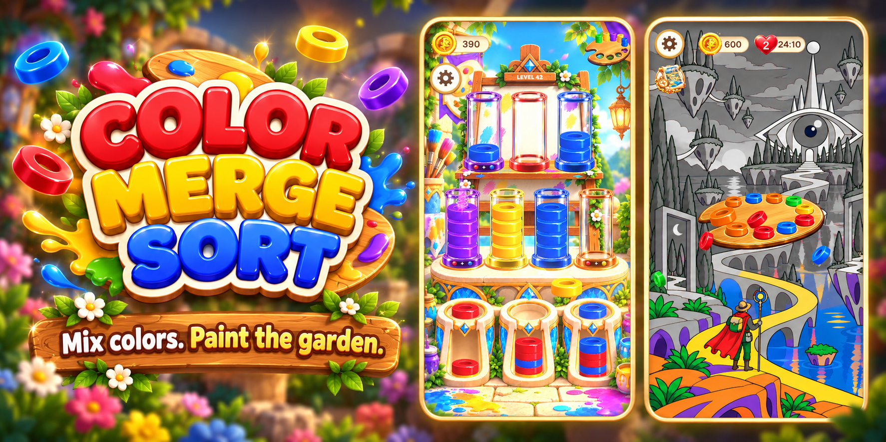
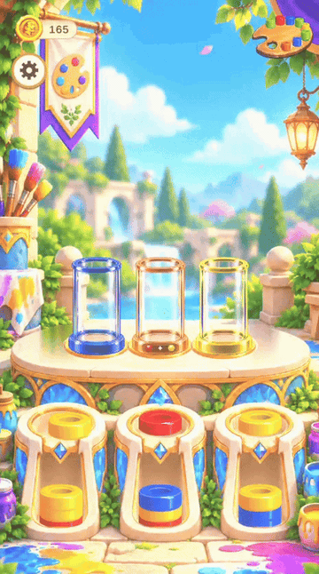
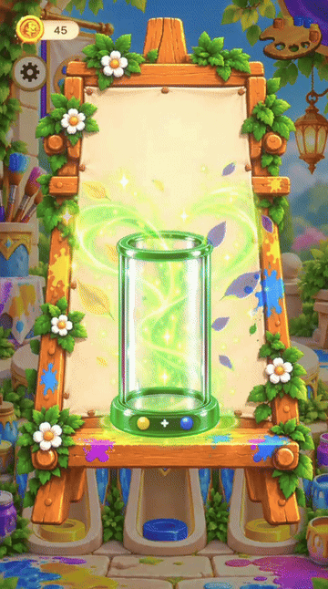
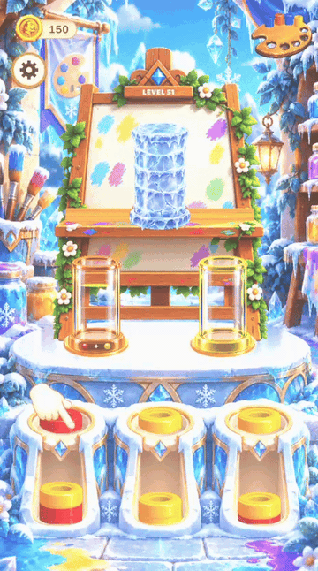
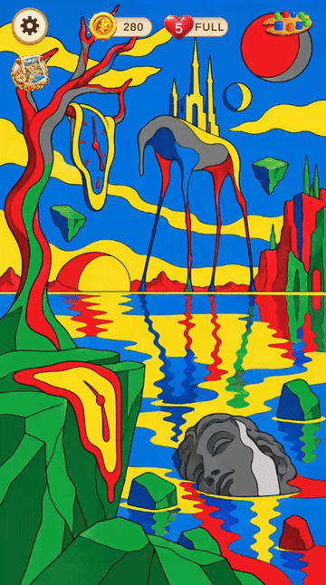
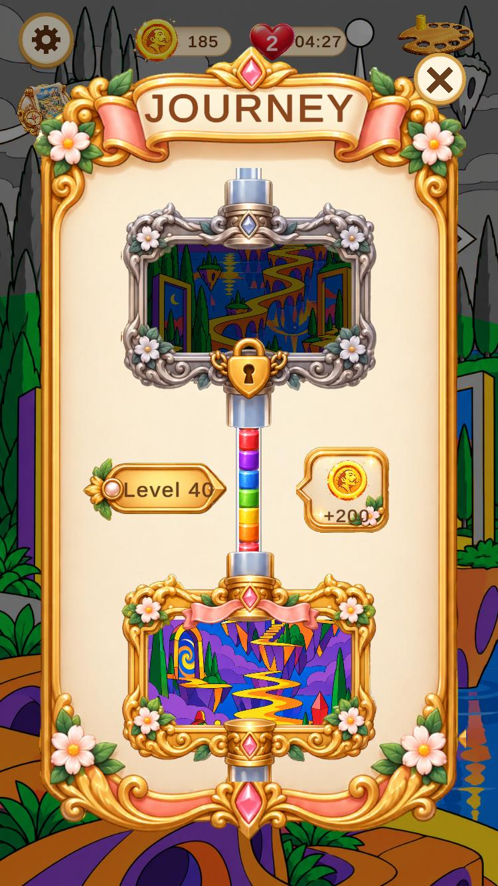
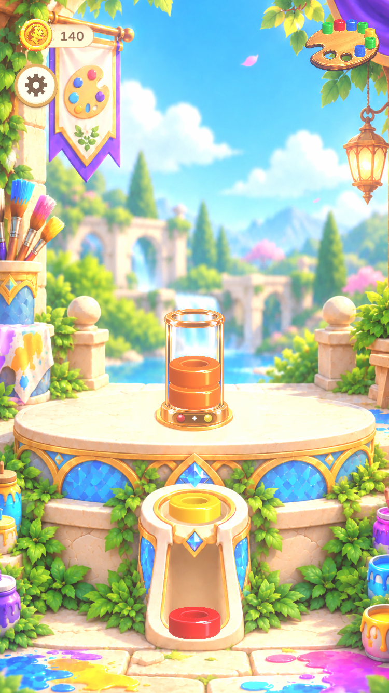
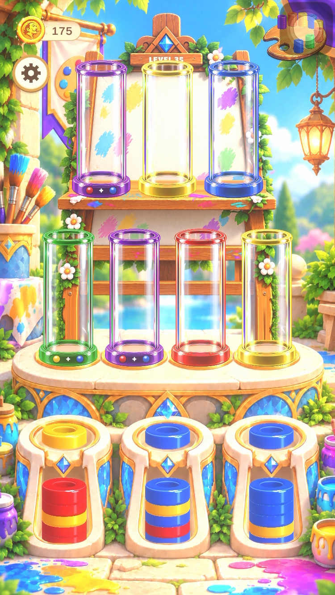
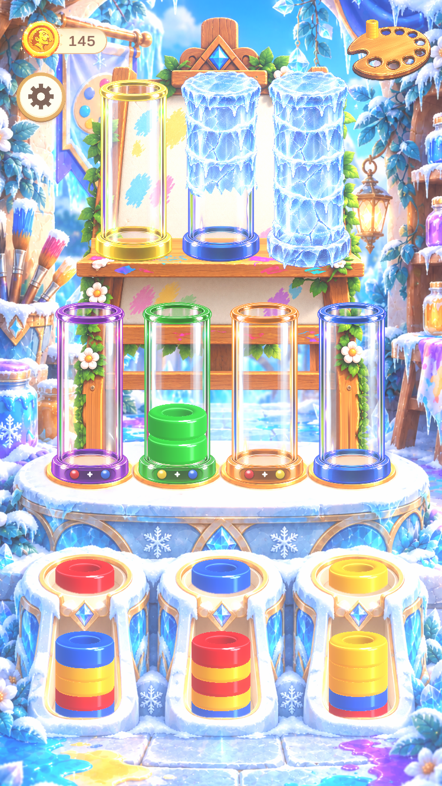

  

# Color Merge Sort

A calm but tricky mobile puzzle game. Mix primary colors into secondary colors, fill every tube with its own color, and paint a black-and-white garden back to life.

Built solo with Unity 6 (URP 2D) for iOS. **Coming soon to the App Store.**

  

## How to play

- Discs come in the three primary colors: **red, yellow and blue**. They wait in three columns at the bottom of the screen, and you can see the next few discs coming in each column.
- Drag a disc from a column onto a tube.
- Each tube shows the color it needs to be filled with. Primary tubes take their own color directly.
- Secondary-color tubes are filled by mixing two primaries inside the tube:
  - Red + Yellow = **Orange**
  - Yellow + Blue = **Green**
  - Blue + Red = **Purple**
- Once one primary color goes into a tube, the next disc has to be its partner. A green tube that got a yellow disc now wants blue. Drop the blue in and the two merge into one green layer.
- The level is complete when every tube is filled with its color.

  

## What makes it tricky

A disc can often go to more than one tube. A move that looks fine now can leave you stuck a few moves later, so you need to look at the discs coming next and plan ahead. If you get stuck, you can undo.

  

## A game that grows with you

New ideas are introduced one at a time, so the game never dumps everything on you at once:

- **Green** is the first color you learn to mix, then **orange**, then **purple**.
- Levels grow from a few small tubes into two rows of bigger tubes.
- **Frozen tubes:** some tubes start covered in ice. Every merge you make anywhere on the board cracks one layer, and only a thawed tube can be used. You need to plan which merges to make first.

  

## Painting the garden

Completed tubes are collected in a palette. When the palette is full, the tubes pour their colors into a black-and-white garden picture and bring it to life piece by piece. Finish a picture to unlock the next one.

  

## Journey

The Journey map shows how far you've come, which color or mechanic unlocks next, and the rewards waiting along the way.

  

## Screenshots

  
  
  
  

## Under the hood

- Unity 6, URP 2D, C#, built for iOS
- Drag-and-drop disc input with merge and pour animations
- A built-in level solver and a deterministic analysis bot, used to check that every level can be solved and to tune difficulty across chapters
- Data-driven levels, color unlocks and progression

---

This repository is a showcase only and does not include the game's source code.
